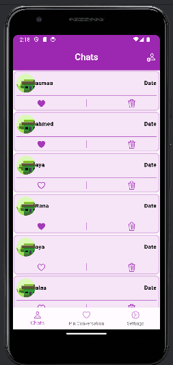
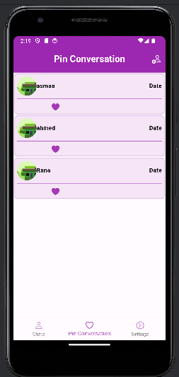
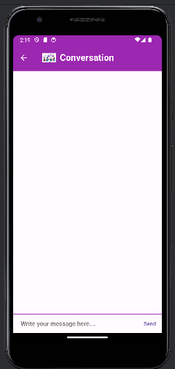
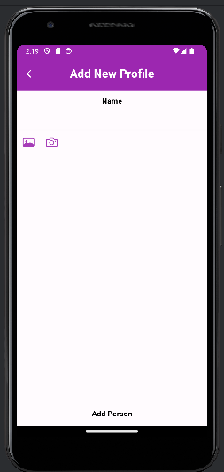
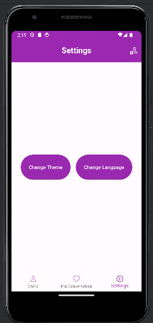
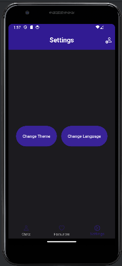
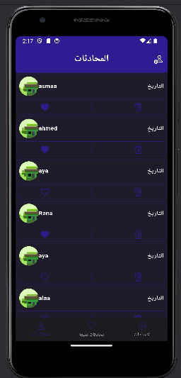
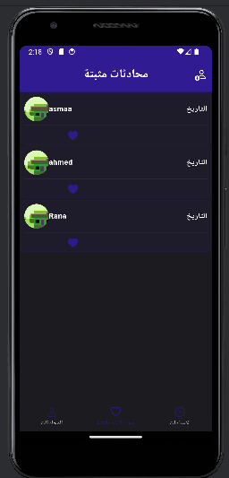

# ChatApp

A cross-platform real-time chat application built with **Flutter** and **Firebase**.

## Features

- **Real-time messaging** – messages are sent and received instantly through Cloud Firestore streams, ordered by time.
- **Authentication** with Firebase Auth:
  - Sign up and log in with email and password
  - Email verification (verification link sent on sign-up, with resend)
  - Forgot password (reset link sent by email)
  - Change password from Settings (re-authenticates with the current password first)
  - Log out
- **Contacts** – add contacts with a name and a profile picture from the gallery or camera, and mark favorites.
- **Local storage** – contacts and favorites are stored locally with SQLite; onboarding state and preferences are saved with SharedPreferences.
- **Light / dark theme** and **English / Arabic** language switch.
- Animated **onboarding**, native splash screen and custom app icons.

## Tech Stack

| Area | Technology |
| --- | --- |
| Framework | Flutter (Dart) |
| State management | BLoC / Cubit (`flutter_bloc`) |
| Backend | Firebase Authentication, Cloud Firestore |
| Local storage | SQLite (`sqflite`), SharedPreferences |
| Other | `image_picker`, `google_fonts`, `flutter_svg`, `smooth_page_indicator`, `flutter_native_splash` |

## Project Structure

The code is organized by feature. Each feature has its own model, view and controller (Cubit) layers.

```
lib/
├── core/                 # routing, shared widgets, validation, utilities
└── features/
    ├── auth/             # onboarding, welcome, login, sign-up,
    │                     # verification, forgot & change password
    └── dashboard/
        ├── modules/      # chats, favorites, new chat, settings
        ├── pages/        # chat room
        └── core/         # theme and app-wide cubit
```

## Getting Started

1. Install [Flutter](https://docs.flutter.dev/get-started/install).
2. Clone the repository:
   ```bash
   git clone https://github.com/Asmaa-Elkilany/ChatApp.git
   cd ChatApp
   ```
3. Install dependencies:
   ```bash
   flutter pub get
   ```
4. Connect your own Firebase project (optional – the repo already includes a config):
   ```bash
   dart pub global activate flutterfire_cli
   flutterfire configure
   ```
   In the Firebase console, enable **Email/Password** sign-in and create a **Cloud Firestore** database.
5. Run the app:
   ```bash
   flutter run
   ```

## Screenshots

| Chats | Pinned conversations | Conversation | Add contact |
| :---: | :---: | :---: | :---: |
|  |  |  |  |

| Settings | Dark mode | Arabic – chats | Arabic – pinned |
| :---: | :---: | :---: | :---: |
|  |  |  |  |
